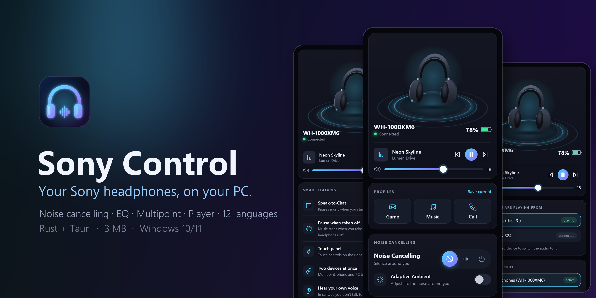
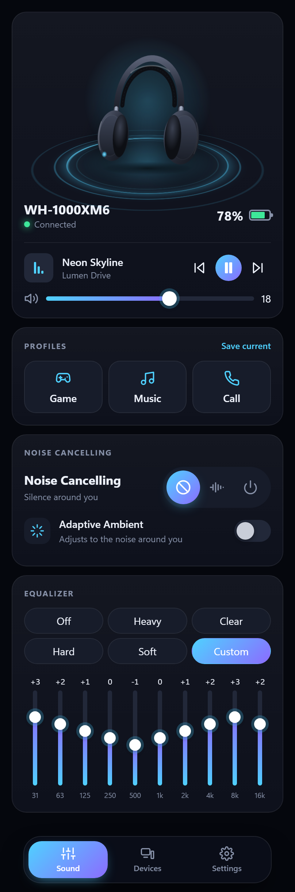
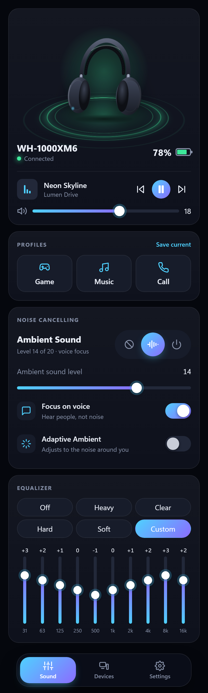
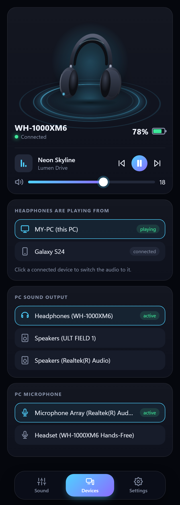
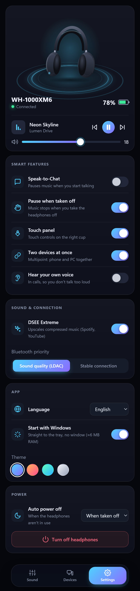

<p align="center">
  
</p>

<p align="center">
  <a href="https://github.com/aResiy/sony-control/releases/latest"></a>
  
  
  
</p>

<p align="center">
  <b>Control your Sony headphones from Windows</b> — noise cancelling, EQ, multipoint, player and more.<br>
  Like the Sound Connect phone app, but on your PC. Tiny (3 MB), fast, and it lives quietly in the tray.
</p>

---

## Screenshots

<p align="center">
  
  
  
  
</p>

## Features

| | |
|---|---|
| 🎧 **Noise control** | Noise Cancelling / Ambient / Off, ambient level, voice focus, adaptive ambient with sensitivity |
| 🎚️ **Equalizer** | Heavy, Clear, Hard, Soft presets and a 10-band custom EQ |
| ▶️ **Player** | Track title, play / pause / next / previous, headphone volume |
| 📱 **Multipoint** | See which devices the headphones are connected to and move the audio between phone and PC in one click |
| 🔊 **PC audio** | Switch the Windows sound output and microphone; warns when the Bluetooth headset mic would ruin sound quality |
| 🎮 **Profiles** | Game / Music / Call — each remembers noise mode, EQ, output and mic |
| ⚙️ **Headphone settings** | Speak-to-Chat, pause when taken off, DSEE Extreme, LDAC vs. stable connection, touch panel, multipoint, sidetone, auto power off, power off |
| 🔔 **Tray** | Battery and quick noise-mode switching without opening the window; low battery notifications at 20% and 10% |
| 🚀 **Light** | Starts with Windows straight into the tray (~6 MB RAM); the window is unloaded when closed |
| 🎨 **Themes** | Four color themes and an animated 3D scene |

**Tested on WH-1000XM6.** Other Sony headphones that use the same protocol (WH-1000XM5, WF-1000XM5, LinkBuds and others) should work too; available features depend on the model.

## Languages

English · Українська · Español · Português · Deutsch · Français · Italiano · Polski · Русский · 简体中文 · 日本語 · 한국어

The app follows your Windows language and can be switched in **Settings → App → Language**.

## Install

1. Pair and connect your headphones in **Windows Settings → Bluetooth & devices**.
2. Download `SonyControl.exe` from the [latest release](https://github.com/aResiy/sony-control/releases/latest) and run it. No installer needed.
3. The app finds the headphones by itself.

> Windows SmartScreen may warn about an unknown publisher because the app isn't code-signed. Click **More info → Run anyway**, or build it yourself from source.

## FAQ

**Can I use LDAC on the PC?** No — Windows doesn't support LDAC. The *Sound quality (LDAC)* switch changes what the headphones prefer, which matters on Android phones.

**Why does sound get worse when I use the headphone mic on PC?** Bluetooth switches to the low-quality hands-free profile while the mic is in use. Pick another microphone in the **Devices** tab to keep music in high quality.

**Another app is already connected.** Close other headphone control apps (for example SonyHeadphonesClient): only one app on a PC can talk to the headphones at a time.

## Build from source

Requirements: [Rust](https://rustup.rs) and Visual Studio Build Tools with the C++ workload.

```bash
cargo build --release
```

The app is `target/release/sony-control.exe`. Run the tests with `cargo test`.

## Credits

The headphone protocol (MDR) is ported to Rust from [mos9527/SonyHeadphonesClient](https://github.com/mos9527/SonyHeadphonesClient) (MIT),
a continuation of [Plutoberth/SonyHeadphonesClient](https://github.com/Plutoberth/SonyHeadphonesClient). See [LICENSE](LICENSE).

## Disclaimer

This is an unofficial, non-commercial project and is not affiliated with or endorsed by Sony.
Sony and WH-1000XM6 are trademarks of Sony Group Corporation.

---

<details>
<summary><b>Українською</b></summary>

**Sony Control** — легка програма для Windows, щоб керувати навушниками Sony з комп'ютера, як застосунком Sound Connect на телефоні: шумоподавлення, еквалайзер, Multipoint, плеєр, профілі, вибір звуку й мікрофона ПК, сповіщення про заряд і швидке меню в треї.

1. Підключи навушники через Bluetooth у налаштуваннях Windows.
2. Скачай `SonyControl.exe` з [останнього релізу](https://github.com/aResiy/sony-control/releases/latest) і запусти.
3. Мову можна змінити в **Settings → App → Language** (за замовчуванням — мова Windows).

</details>
